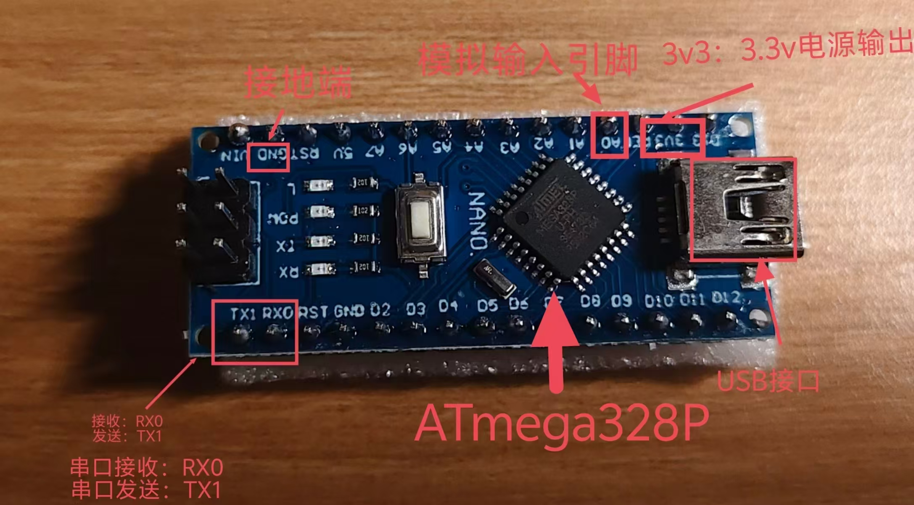

# Day 1(2026/10/13): Arduino Basic Theory and Serial Communication
## 1. Arudino Nano over Uno?
- **Same close**: Both use the ATmega328P chip. Their logic and progamming methods are identical.
- **Physical Size**: Nano is smaller and cheaper.
- **Project Needs**: For future brain-complete interface (BCI) and wearable iterations, the compact Nano is much more suitable.

## 2. Signal and communication Basics
- **Digital Signal**: Only contains 0 and 1. Stable transmission and strong anti-interference ability. (That why I bought Arduino Nano, orderly transform the signals)
- **Analog Signal**: Continuously chaning physical quantity (e.g., sound, voltage). Easily afffected by noise. Bio-signals (ECG/EEG) are typical analog signals, which must undergo AD conversion before a computer can process them.
- **Serial Communication**: Uses one data line to transmit data bit by bit.

## 3. Two "Iron Rules" of Serial Communication
- **Sample Speed**: Must use the same baud rate (commonly 9600 bps).
- **Same Encoding**: Characters must use a unified encoding, usually ASCII.

## 4. Core Code Cheatsheet
- **Initialization (Put in 'setup()', runs once)**:
 - 'Serial.begin(9600);' Initializes serial communication, sets baud rate.
- **Sending Data (Output)**:
 - 'Serial.print(val);' Print without a newline.
 - 'Serial.println(val);'print with a newline.
 - *Note*: Use double quotes ' "" ' for strings, single quotes ' '' ' for characters.
- **Receving Data (Input, in 'loop()')**:
 - 'Serial.available();' Returns the number of bytes waiting in the buffer.
 - 'Serial.read();' Reads and returns one byte (char type) each time.

## 5. Physical Pin Annotation (Pending)
- 

## Learing Insights (AI-Assisted)
In today's theoretical study, I was confused about "serial communication" and "how the board runs independently". By watching Bilibili videos and asking AI some key questions (e.g., "why can the board run without being connected to a computer and how can computer send the oders to the board"). After figuring it out, I built the full logic chain: **Code is burned into the chip -> Hardware runs independently -> Sends data via USB -> Python on the computer receives it.** Connecting "abstract code" to the "physical world" feels amazing.

---
## References
- Link: 
 - [https://www.bilibili.com/video/BV164411J7GE/?spm_id_from=333.788.videopod.episodes&p=4]
 - [https://www.bilibili.com/video/BV164411J7GE/?spm_id_from=333.788.videopod.episodes&p=7]
 - [https://www.bilibili.com/video/BV19d4y157Hw/?spm_id_from=333.788.top_right_bar_window_history.content.click&vd_source=3cc578b419c0a41c2b114dbae2edafd8]
- AI Assistant (Deepseek) :Used for clarifying hardware/software concepts.
 
